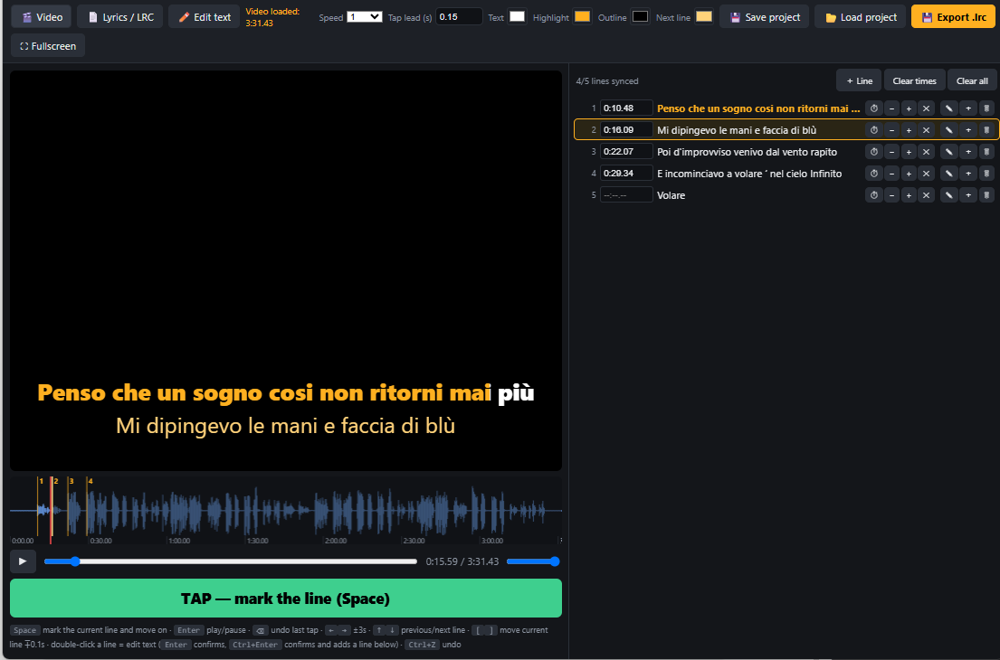

# Karaoke Sync

[🇮🇹 Italiano](README.it.md) · 🇬🇧 English

A simple tool to **sync lyrics to a video or an audio track** and produce a karaoke video where the words light up in time.

You press a key while the video plays: each press marks the start of the next line. Then you fine-tune the result on the waveform. No accounts, nothing to install for the syncing part: it is a single HTML page that runs in your browser.



## Features

- **Tap sync**: `Space` (or a click on the video) assigns the current time to the current line and moves on to the next one.
- **Waveform** above the progress bar, with zoom (mouse wheel), panning (drag) and the line start markers drawn on top. Markers can be **dragged** for precise corrections.
- **Text editing** line by line (double-click), adding and deleting lines, empty lines for instrumental breaks. Timings are kept. `Ctrl+Z` undoes.
- **Original / cover texts**: every line can hold two texts. The **🔤 Showing: Cover / Original** button switches which one is shown, edited, previewed and rendered; the other one stays visible in small grey under each line, handy when writing a cover over the original lyrics.
- **Colour sweep that follows the singing**: each line can have an end marker (blue, dashed) saying where the singing stops. **⇥ Auto ends** finds them from the waveform, and you can drag them. The render then fills the line exactly from its start to that end, instead of spreading it over the gap to the next line.
- **Slow playback** (0.5x, 0.75x) and an adjustable **tap lead** to compensate for reaction time.
- **Configurable colors** (text, highlight, outline, next line) for bright or dark videos.
- **Autosave** in the browser, **Save / Load project** as `.karaoke.json`, `.lrc` export.
- **Final render** with ffmpeg: a video with the lyrics burned in, frame-accurate. Also works with an audio-only file (black background).

## Requirements

| What | Needed for | Notes |
|---|---|---|
| Chrome or Edge browser | sync page | Firefox works, but files always go to Downloads |
| Python 3 | final render | standard library only (tkinter is also needed, included by default) |
| ffmpeg | final render | Windows: `winget install Gyan.FFmpeg` |

The sync page needs nothing. Python and ffmpeg are only needed for the render, which lives in the [`render/`](render/) folder: `install_requirements.bat` there checks for them and installs whatever is missing (full instructions in [`render/README.md`](render/README.md)).

Tested on **Windows 11** only. The sync page is plain HTML and should work the same on any system. The `.bat` files are Windows-only, but `render/render.py` is plain Python and can be run on Linux and macOS too: see [Linux and macOS](render/README.md#linux-and-macos). Launchers and installers for those systems are welcome as contributions.

## How to use

### 1. Sync

1. Open `karaoke.html` (double-click).
2. **🎬 Video** → choose the video or audio file. **📄 Lyrics / LRC** → choose the lyrics file, one line per verse (or paste it with **✏️ Edit text**).
3. Start playback with `Enter` and press `Space` when each line begins. Made a mistake? `⌫` undoes the last tap.
4. Fine-tune: drag the orange markers on the waveform, or use `[` and `]` (∓0.1 s) and the buttons on each line.
5. **💾 Save project** → saves `videoname.karaoke.json` next to the video.

> For tracks with separate vocals and backing track, it is easier to sync while listening to the **vocals-only** track (word onsets are much clearer) and then render with the backing track.

### 2. Create the video

The first time, run `render/install_requirements.bat` (installs Python and ffmpeg if missing).

- **Double-click `render/render.bat`**: three dialogs appear — video/audio, timing file, where to save. Rendering then starts with a progress percentage.
- **Or** drag the video onto `render/render.bat`: it looks for `videoname.karaoke.json` (or `.lrc`) next to the video or in Downloads.
- **Or** from a terminal:

  ```bash
  python render/render.py video.mp4 project.karaoke.json output.mp4
  ```

The result is an mp4 (H.264 + AAC). The colors chosen in the page are saved inside the `.karaoke.json` and used by the render.

## Shortcuts

| Key | Action |
|---|---|
| `Space` / click on video | mark the current line |
| `Enter` | play / pause |
| `⌫` | undo the last tap (and go back 2 s) |
| `Del` | clear the time of the selected line |
| `←` `→` | ∓3 seconds |
| `↑` `↓` | previous / next line |
| `[` `]` | move the current line by ∓0.1 s |
| double-click a line | edit its text (`Enter` confirms, `Ctrl+Enter` adds a line below) |
| `Ctrl+Z` | undo line edits |

On the waveform: wheel = zoom, drag = pan, click = seek, drag an orange marker = move the start of that line, drag a blue marker = move the end of its singing, double-click = full view.

## Tips

### Split vocals and backing track with Ultimate Vocal Remover

The trick that makes syncing **much faster**: separate the song into vocals and instrumental with [Ultimate Vocal Remover](https://github.com/Anjok07/ultimatevocalremovergui) (a free program that uses AI models), then:

1. load the **vocals-only** track in the page: on the waveform every word stands out from the rest, so you can see and hear exactly where each line starts;
2. mark the timings with `Space` and correct the markers on the waveform;
3. for the final video, pick the **instrumental** track as the audio source in the render, using the same timing file.

This way the original vocals are not mixed over the backing track, and the timings stay accurate because both stems have the same length. If both files come from the same separation, the `vocals.karaoke.json` file can be used for the instrumental too by selecting it by hand in the second render dialog.

### Writing a cover

Paste the original lyrics first, switch to **Original** and type them in, then switch back to **Cover** and write your own words line by line: the original stays shown in grey under each line, so you can count syllables. Timings are shared by both texts. Use the same button before saving the project to choose which version the video is rendered with.

### Making the colour sweep follow the voice

After syncing the starts, press **⇥ Auto ends** (best with the vocals-only track loaded): it reads the waveform and places a blue end marker where each line stops being sung. Check them while zooming in, and drag any that is off. Without a manual correction, a second click only fills the missing ones; **Shift+click** recalculates all of them. Lines without an end marker keep the old behaviour.

To **add** an end to a line that has none, play the video and click the **⟧** button on that line's row at the moment the singing stops (it needs the line to be synced first); **⇥ Auto ends** also fills every missing one at once. To change one end by hand, zoom in with the wheel and drag its blue marker (`⟧` plus the line number); the video then jumps 1 s before the new end so you can listen to it with `Enter`. `Ctrl+Z` undoes a drag. Save the project afterwards: the render reads the ends from the `.karaoke.json`, not from an `.lrc`.

### Other tips

- If your taps are consistently late or early, adjust **Tap lead**: the value is subtracted from every tap.
- For tricky passages, slow down to **0.5x** and zoom in on the waveform.
- An **empty line** (the ＋ button) clears the text from the screen: use it for instrumental breaks.
- Save now and then with **💾 Save project**: the browser autosave is handy but stays on your computer.

## Formats

- **`.karaoke.json`**: `{ "version": 3, "video": "name", "mode": "cover", "style": { "text", "hi", "outline", "next" }, "lines": [ { "text": "cover", "orig": "original", "t": 12.34, "e": 15.2 } ] }`, with `t` in seconds (`null` if the line is not synced yet). `e` is the optional end of the singing of that line (without it the sweep spans the gap to the next line, at most 6 s). `mode` is `cover` or `orig` and decides which text the render burns in (if a line has no original text, its cover text is used).
- **`.lrc`**: the standard `[mm:ss.xx]text` format. It holds timings but not colors.

## Known limitations

- The waveform decodes the file in the browser: above roughly 600 MB it is skipped (everything else still works).
- Videos the browser cannot play (some `.mkv`, H.265) cannot be synced in the page; convert them to H.264 mp4 or use the audio only.
- The render uses the Arial font and a fixed style (bottom position, size proportional to the video). Change it in `build_ass()` inside `render/render.py`.
- The browser autosave only lives on your own computer: to move or back up your work, use **Save project**.

## How it was made

This project was written by an **AI (Claude, through Claude Code)** following the requests and feedback of a human: the person decided what was needed and how the tool should behave, tried it on real songs and reported every problem, and the AI wrote and fixed the code accordingly. The code has not been reviewed line by line by a developer: it was tested through use, so rough edges are to be expected. Reports and fixes are welcome.

## License

[PolyForm Noncommercial 1.0.0](LICENSE): you may freely use, copy and modify the program for **noncommercial** purposes (personal use, hobby, study, non-profit organizations). Commercial use is not allowed. The software is provided **as is, with no warranty and no liability** on the part of the author.

Note: this is not an open source license in the strict sense, precisely because it forbids commercial use.
